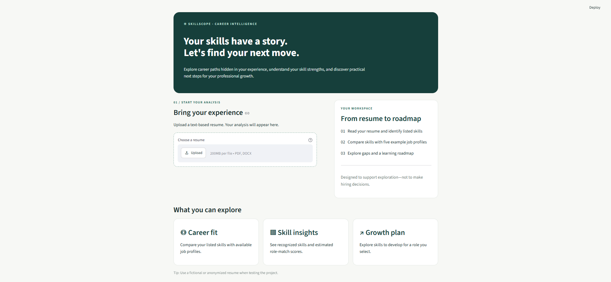
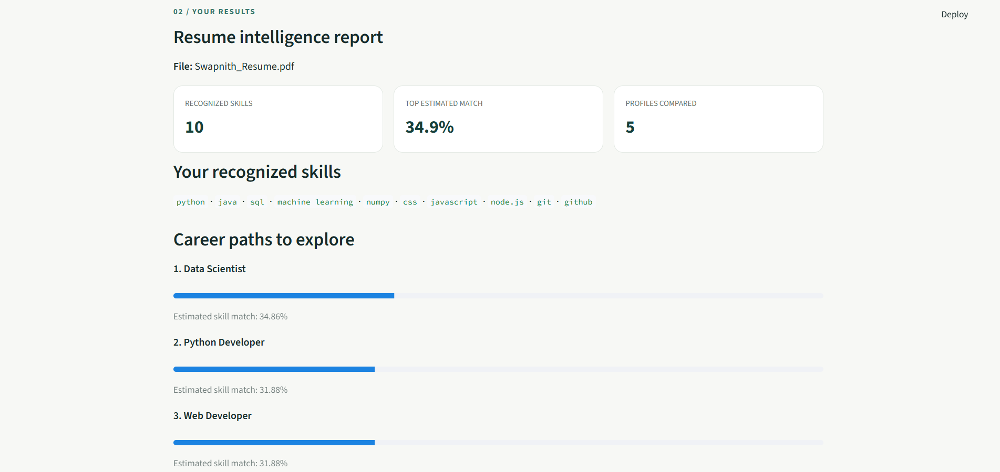
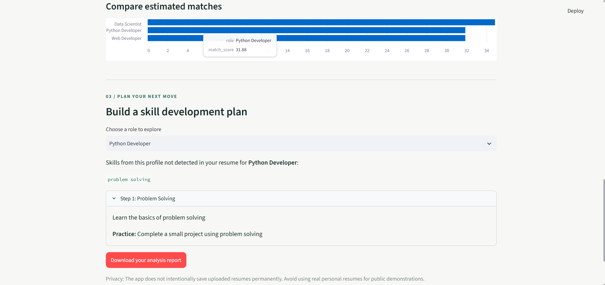

# AI Resume Analyzer and Job Recommendation System
SkillScope is the interface for this project, which analyzes resume text, identifies skills, recommends relevant job roles, and suggests areas for further learning. It is built using Python, Streamlit, and machine-learning techniques.
## Features
- Upload PDF and DOCX resumes
- Validate file size (maximum 10 MB)
- Extract and clean resume text
- Identify skills using a skill dictionary
- Recommend the top three job roles
- Calculate similarity scores using TF-IDF and cosine similarity
- Display job-match scores and a comparison chart
- Identify skills not detected for a selected role
- Generate a basic learning roadmap
- Download a resume analysis report
- Provide responsible-use and privacy guidance
## Technologies Used
- Python
- Streamlit
- pandas
- scikit-learn
- pypdf
- python-docx
- Matplotlib (for the Colab notebook chart)
## Project Structure
```text
ai_resume_analyser/
├── app.py
├── resume_parser.py
├── text_cleaner.py
├── skill_extractor.py
├── job_matcher.py
├── roadmap_generator.py
├── requirements.txt
├── README.md
├── data/
│   ├── job_roles.csv
│   └── skill_dictionary.csv
├── tests/
│   └── test_cases.csv
├── reports/
│   └── workflow_diagram.md
├── screenshots/
│   ├── skillscope_home.png
│   ├── skillscope_analysis.png
│   └── skillscope_roadmap.png
└── sample_resumes/
```
## Installation
1. Install Python.
2. Open a terminal in the project folder.
3. Create a virtual environment:

   ```bash
   python -m venv .venv
   ```

4. Activate it on Windows:

   ```powershell
   .\.venv\Scripts\Activate.ps1
   ```

5. Install the dependencies:

   ```bash
   pip install -r requirements.txt
   ```

## Run the Application

```bash
python -m streamlit run app.py
```

Open the local URL shown in the terminal.

## Datasets
- `skill_dictionary.csv`: Contains skills and their categories.
- `job_roles.csv`: Contains job roles and their required skills.

The current dataset includes five example job profiles. The application does not connect to a live job-listing database.
## Testing
The test sheet is available at `tests/test_cases.csv`. Test PDF and DOCX uploads, unsupported file types, file-size validation, skill extraction, job recommendations, charts, missing skills, learning-roadmap generation, report downloads, and unreadable resumes.
Record the actual result and status for each test after running it.
## Application Screenshots
### SkillScope Homepage

### Resume Analysis and Job Recommendations

### Skill Development Roadmap

## Limitations and Responsible Use
Match scores are similarity estimates, not probabilities of employment or measures of overall ability. Results depend on the resume text, skill dictionary, and available job profiles. A skill not detected in a resume is not necessarily a skill the person lacks.
The current matching approach compares listed skills and does not use protected attributes for ranking. The application is intended for educational and career-exploration purposes, not as the sole basis for hiring decisions.
The application does not intentionally save uploaded resumes to permanent storage. Use fictional or anonymized resumes for demonstrations and avoid publishing resumes containing personal information.
## Deliverables
The project submission includes the source code, datasets, Colab notebook, test sheet, workflow diagram, project summary PDF, and student-recorded demonstration video.
## Project Information
**Project:** AI Resume Analyzer and Job Recommendation System  
**Interface Name:** SkillScope  
**GitHub Repository:** [ai_resume_analyzer](https://github.com/iamthash/ai_resume_analyzer)
