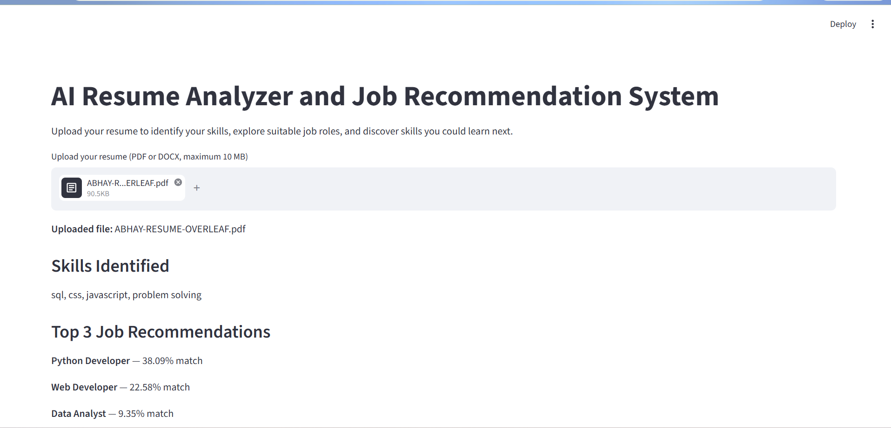
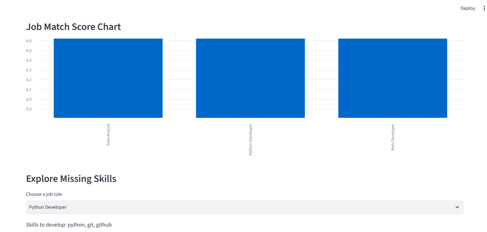
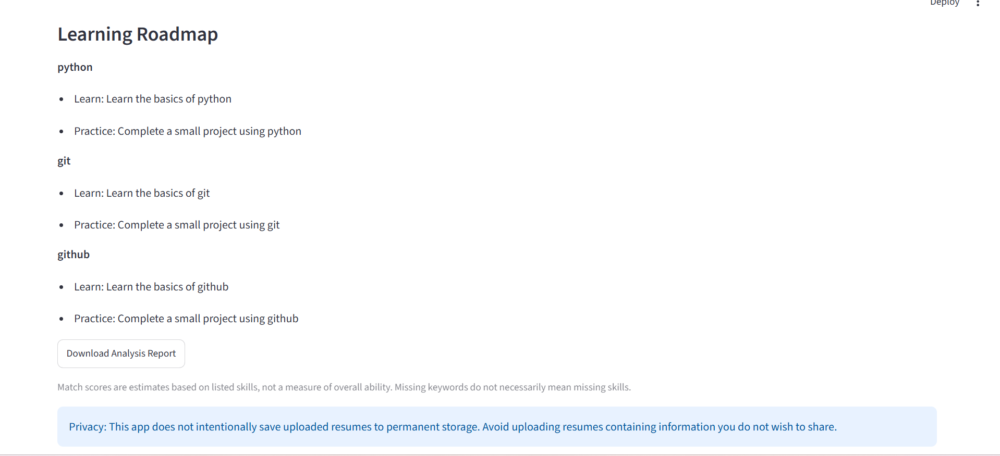

# AI Resume Analyzer and Job Recommendation System
## Project Overview
This project analyzes a resume, identifies skills, recommends suitable job roles, and suggests skills to improve. It uses Python, Streamlit, and machine-learning techniques.
## Features
- Upload PDF and DOCX resumes
- Validate file size (maximum 10 MB)
- Extract and clean resume text
- Identify skills using a skill dictionary
- Recommend the top three job roles
- Calculate similarity scores using TF-IDF and cosine similarity
- Display a job-match chart
- Identify missing skills for a selected role
- Generate a basic learning roadmap
- Download an analysis report
## Technologies Used
- Python
- Streamlit
- pandas
- scikit-learn
- pypdf
- python-docx
- Matplotlib (for the Colab notebook chart)
## Project Structure
```text
ai_resume_analyser/
├── app.py
├── resume_parser.py
├── text_cleaner.py
├── skill_extractor.py
├── job_matcher.py
├── roadmap_generator.py
├── requirements.txt
├── README.md
├── data/
│   ├── job_roles.csv
│   └── skill_dictionary.csv
├── tests/
│   └── test_cases.csv
├── reports/
│   └── workflow_diagram.md
└── sample_resumes/
```

## Installation
1. Install Python.
2. Open a terminal in the project folder.
3. Create a virtual environment:

   ```bash
   python -m venv .venv
   ```

4. Activate it on Windows:

   ```powershell
   .\.venv\Scripts\Activate.ps1
   ```

5. Install the dependencies:

   ```bash
   pip install -r requirements.txt
   ```
## Run the Application
```bash
python -m streamlit run app.py
```

Open the local URL shown in the terminal.
## Datasets
- `skill_dictionary.csv`: skills and their categories.
- `job_roles.csv`: job roles and their required skills.
## Testing
Test PDF and DOCX uploads, unsupported files, file-size validation, skill extraction, recommendations, charts, missing skills, learning roadmap, report download, and unreadable resumes. Record actual results in `tests/test_cases.csv`.


## Application Screenshots





## Limitations and Responsible Use
Match scores are similarity estimates, not probabilities of employment or measures of overall ability. Results depend on resume text, the skill dictionary, and the defined job roles. Missing keywords do not necessarily mean a person lacks a skill. Do not use protected attributes to rank candidates.
The application does not intentionally save uploaded resumes to permanent storage. Avoid uploading resumes containing information you do not wish to share.
## Deliverables
The project submission includes the source code, datasets, Colab notebook, test sheet, workflow diagram, project summary PDF, and student-recorded demonstration video.
