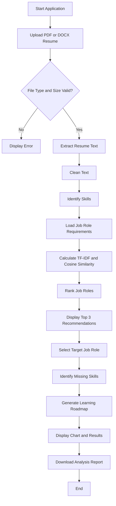

# AI Resume Analyzer — Workflow Diagram

## Workflow Description
1. The user uploads a PDF or DOCX resume.
2. The application validates the file type and size.
3. Resume text is extracted and cleaned.
4. Skills are identified using the skill dictionary.
5. Extracted skills are compared with job-role requirements.
6. The application recommends the top three matching roles.
7. The user selects a target role to view missing skills.
8. A basic learning roadmap is generated.
9. Results are displayed and can be downloaded as a report.